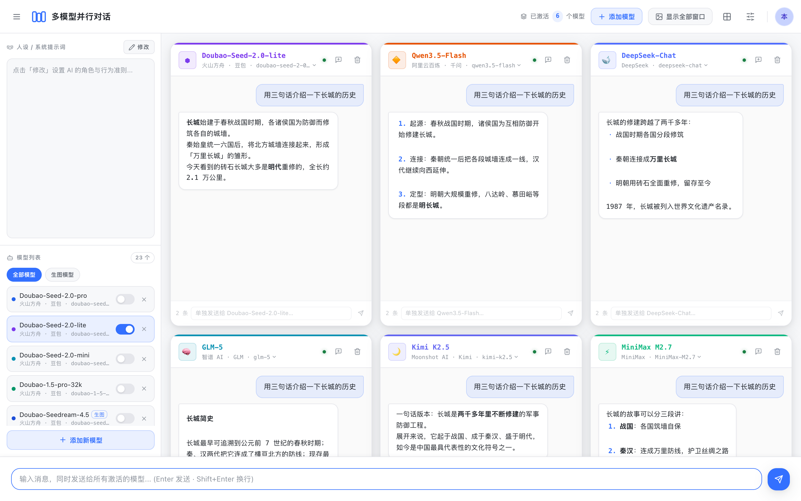
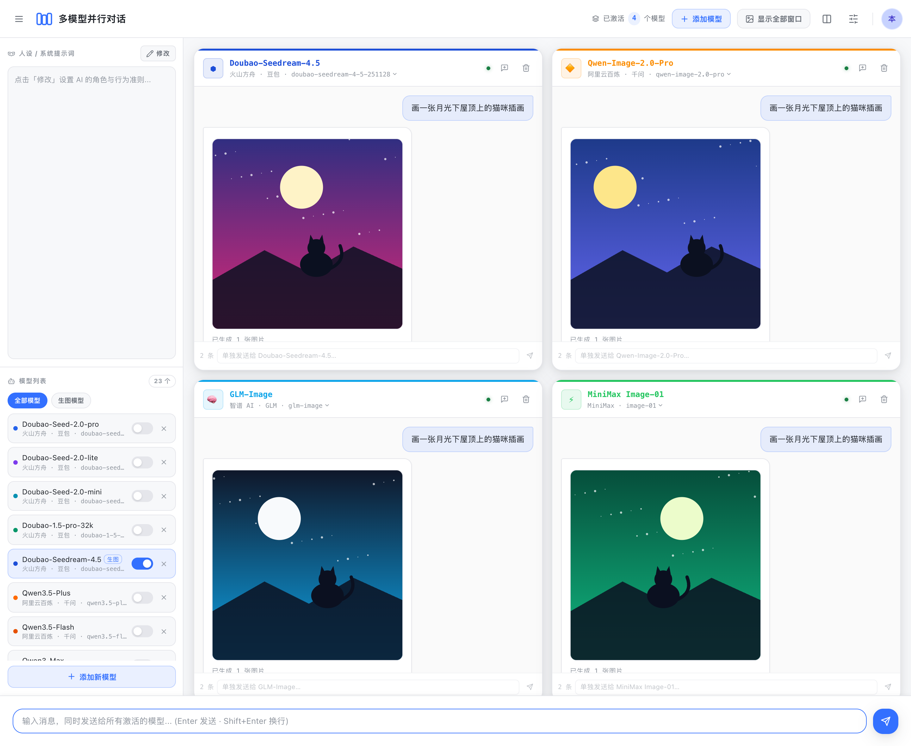
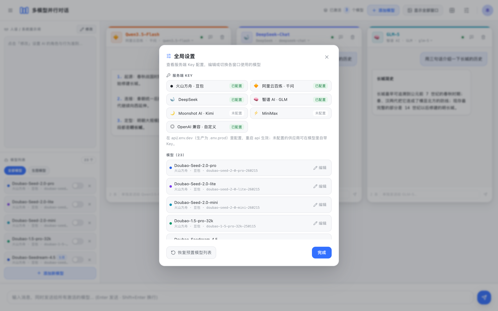
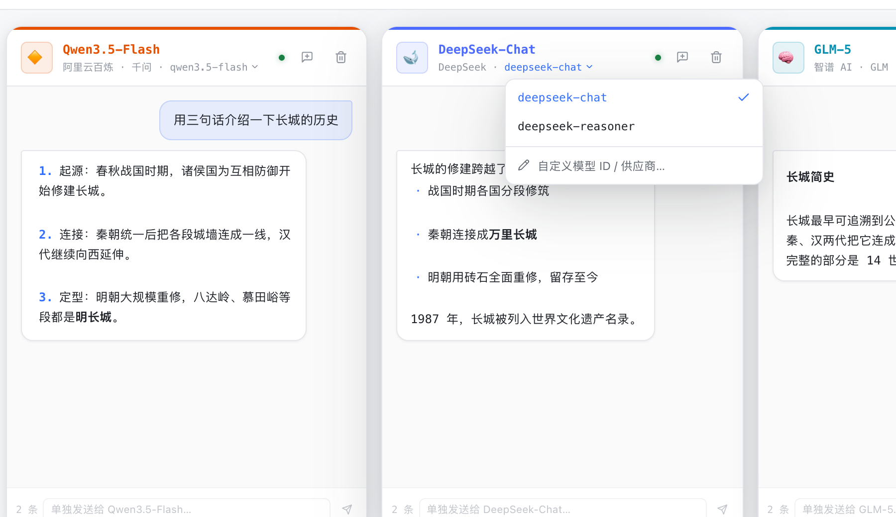
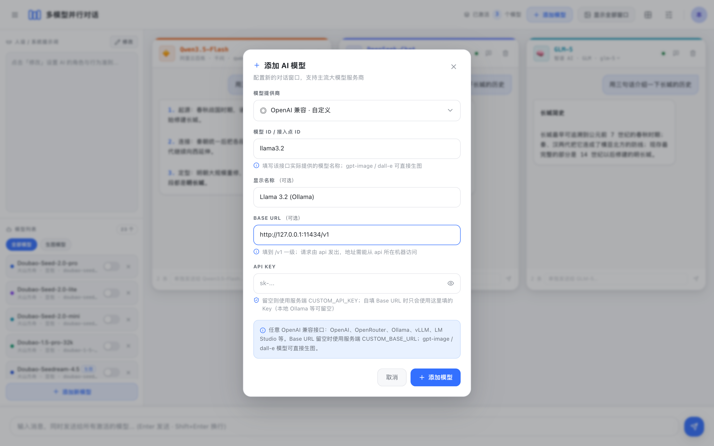
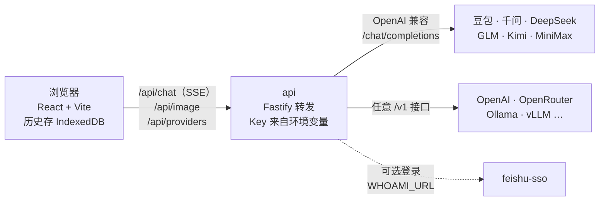

# multi-model-chat

[English](README.md) | 简体中文

多模型并行对话：一句话同时发给多个大模型，各窗口独立流式输出，直接对比回答质量；也能并排对比文生图效果。



> 本文截图使用的是模拟的演示回答（见[重新生成截图](#重新生成截图)）。

## 功能

- **并行对比**：输入框广播给所有已激活的模型，每个窗口独立流式输出；也可以在单个窗口里只问某一个模型。
- **七类供应商、预置 23 个模型**：火山方舟（豆包）、阿里云百炼（千问）、DeepSeek、智谱（GLM）、月之暗面（Kimi）、MiniMax，以及**任意 OpenAI 兼容接口**（OpenAI、OpenRouter、Ollama、vLLM、LM Studio 等）。
- **随时切换模型**：在窗口标题栏的下拉里换版本，或在「全局设置」里编辑任意模型的供应商、模型 ID、显示名称、Key 和 Base URL，切换后对话历史保留。
- **文生图对比**：qwen-image、glm-image / CogView、doubao-seedream、MiniMax image-01 和 OpenAI gpt-image / dall-e 并排出图；消息看起来是要图时自动走生图接口。
- **开箱即用的默认值**：首次打开时只激活服务端已配 Key 的供应商的模型，只配一家也不会满屏报错。
- **灵活配置**：统一下发人设（系统提示词）、单个模型自带 API Key、5 种网格布局、3 套皮肤。
- **数据留在本地**：会话历史存在浏览器 IndexedDB，模型列表与设置存在 localStorage，服务端不落库。
- **Key 只在服务端**：厂商 Key 只存在于 api 的环境变量里，浏览器拿不到。

| 文生图对比 | 全局设置 |
| --- | --- |
|  |  |

| 窗口内切换模型版本 | 添加 OpenAI 兼容模型（如 Ollama） |
| --- | --- |
|  |  |

## 快速开始

需要 Node.js ≥ 20.19（推荐 22 或 24）和 pnpm 9（`corepack enable` 即可安装）。

```bash
git clone https://github.com/AI-Pocket-Verse/multi-model-chat.git
cd multi-model-chat
pnpm install
pnpm dev          # 首次运行自动生成 api/.env.dev，然后同时启动 api（:4060）和 web（:5160）
```

打开 <http://localhost:5160> 即可使用。默认是**本地单用户模式**，无需登录。

然后用以下任一方式配置 Key：

1. **服务端配置（推荐）**：在 `api/.env.dev` 里填写一个或多个 `*_API_KEY`（见[配置](#配置)），重启 `pnpm dev`。
2. **单个模型自带**：打开右上角「全局设置」→「编辑」某个模型，填入它自己的 Key。这个 Key 只保存在本地浏览器，每次请求随请求发给 api 转发。

两处都没有 Key 时，窗口里会提示该去配置哪个变量。

## 用 Docker 运行

```bash
cp api/.env.example api/.env.docker   # 可选：在这里填厂商 Key
docker compose up -d --build
```

打开 <http://localhost:4060>。一个镜像同时提供前端和 api；因为本地模式不鉴权，端口只映射到宿主机的 `127.0.0.1`。容器里要访问宿主机上的 Ollama，自定义模型的 Base URL 填 `http://host.docker.internal:11434/v1`。

## 接入 OpenAI 兼容接口

添加或编辑模型时选择「OpenAI 兼容 · 自定义」：

| 服务 | Base URL | API Key |
| --- | --- | --- |
| OpenAI | `https://api.openai.com/v1` | 必填 |
| OpenRouter | `https://openrouter.ai/api/v1` | 必填 |
| Ollama（本机） | `http://127.0.0.1:11434/v1` | 留空 |
| vLLM / LM Studio | 你的服务的 `/v1` 地址 | 视服务而定 |

想让所有用户共用一个接口时，在服务端设置 `CUSTOM_BASE_URL` / `CUSTOM_API_KEY`，界面里的 Base URL 留空即可。名为 `gpt-image-*` 或 `dall-e-*` 的模型会通过 `/images/generations` 生图。

请求由 api 发出，所以 Base URL 必须能**从 api 所在机器**访问。安全规则：

- 服务端的 `CUSTOM_API_KEY` **绝不会**发往浏览器填写的 Base URL，这种情况下只使用该模型自己填的 Key。
- 浏览器自填 Base URL 在本地模式下允许，**开启登录后默认禁止**（`ALLOW_USER_BASE_URL`）：多人共用的服务器上，任意地址等于让用户借服务器探测内网（SSRF）。
- 只接受 `http://` 和 `https://` 地址。

## 工作原理



- `/api/chat` 把厂商的 SSE 流原样透传给浏览器，api 不解析、不改写；厂商报错时状态码和 body 也原样透传，并带 `x-upstream-error` 头，让前端区分「厂商的 401」和「自己没登录的 401」。
- 浏览器断开连接时，api 会同步取消发往厂商的请求，关掉页面就不再计费；前端 120 秒收不到任何数据会中止该模型并提示超时，回复中途断开会标注「回复被中断」。
- 失败和中断的回复不会作为上下文发给下一轮。

## 配置

api 用 Node 原生的 `--env-file` 加载配置：`pnpm dev` 读 `api/.env.dev`，`pnpm start` 读 `api/.env.prod`，Docker 读 `api/.env.docker`。这些文件都不入库，模板是 [`api/.env.example`](api/.env.example)。

| 变量 | 默认 | 说明 |
| --- | --- | --- |
| `ARK_API_KEY` | 空 | 火山方舟（豆包），在[方舟控制台 API Key 管理](https://console.volcengine.com/ark/region:ark+cn-beijing/apiKey)创建 |
| `QWEN_API_KEY` | 空 | 阿里云百炼（千问），见[获取与配置 API Key](https://help.aliyun.com/zh/model-studio/get-api-key) |
| `DEEPSEEK_API_KEY` | 空 | DeepSeek，在 [API keys](https://platform.deepseek.com/api_keys) 页面创建 |
| `ZHIPU_API_KEY` | 空 | 智谱（GLM），在[智谱开放平台 API Keys](https://bigmodel.cn/usercenter/proj-mgmt/apikeys) 创建 |
| `KIMI_API_KEY` | 空 | 月之暗面（Kimi），在 [Kimi 开放平台 API Keys](https://platform.moonshot.cn/console/api-keys) 创建 |
| `MINIMAX_API_KEY` | 空 | MiniMax，见[如何获取 API Key](https://platform.minimaxi.com/docs/faq/about-apis) |
| `CUSTOM_BASE_URL` / `CUSTOM_API_KEY` | 空 | 默认的 OpenAI 兼容接口地址与 Key，如 `https://api.openai.com/v1` |
| `ALLOW_USER_BASE_URL` | 自动 | 是否允许浏览器自填 Base URL；留空时本地模式允许、登录模式禁止 |
| `HOST` / `PORT` | `127.0.0.1` / `4060` | api 监听地址 |
| `ALLOWED_HOSTS` | 空 | 本地模式只接受 Host 为 `localhost` / `127.0.0.1` / `::1` 的请求（防 DNS 重绑定），用域名或局域网 IP 访问时加在这里 |
| `TRUST_PROXY` | `loopback` | 信任的反向代理（IP / 网段列表），限流按真实客户端 IP 分桶；不接受跳数和 `true` |
| `CORS_ORIGINS` | 空 | 同源部署留空；跨域直连时填逗号或空格分隔的来源 |
| `WEB_DIST_DIR` | 未设置 | 由 api 同时托管 `web/dist`（Docker 使用） |
| `WHOAMI_URL` | 未设置 | 设置后启用飞书登录，见下节 |

### 可选：飞书登录

不设置 `WHOAMI_URL` 时为本地单用户模式。需要多人使用时，可以接入同系列开源项目 [feishu-sso](https://github.com/AI-Pocket-Verse/feishu-sso)（飞书统一登录服务）：

1. 部署 feishu-sso，并让反向代理把同一域名下的 `/auth/*` 转发给它（登录 cookie 依赖同源）。
2. api 设置 `WHOAMI_URL`，指向 feishu-sso 的 whoami 接口，例如 `http://127.0.0.1:4020/api/whoami`。
3. web 构建时设置 `VITE_SSO_BASE=/auth`（可写在 `web/.env.local`）。

两端需同时配置：只配一端时，前端与后端对「当前用户」的判断会不一致。接入后未登录的请求会被拒绝（401），不会动用服务端 Key。

## 安全提示

- **本地模式不鉴权**：能访问到 api 的人都能用你配置的 Key 调模型、产生费用。所以 `HOST` 默认只监听本机，Docker 也只映射到 `127.0.0.1`；要给别人用，请先开启登录。
- 在界面里填写的 Key 以明文保存在浏览器 localStorage，只在自己信任的设备上使用。
- 厂商返回的图片地址只放行 `http(s)` 和 `data:image`，模型输出渲染前会做 HTML 转义。

## 部署（systemd + nginx）

`deploy/` 提供单机部署模板：nginx 托管前端静态文件并反代 api，已关闭对流式回复的缓冲。

```bash
git clone https://github.com/AI-Pocket-Verse/multi-model-chat.git /opt/multi-model-chat && cd /opt/multi-model-chat
pnpm install && pnpm build
cp api/.env.example api/.env.prod   # 改为 NODE_ENV=production，填入 Key 和 WHOAMI_URL

sudo cp deploy/systemd.service.template /etc/systemd/system/multi-model-chat.service
sudo sed -i 's|__INSTALL_DIR__|/opt/multi-model-chat|; s|__SERVICE_USER__|www-data|' /etc/systemd/system/multi-model-chat.service
sudo systemctl daemon-reload && sudo systemctl enable --now multi-model-chat

sudo cp deploy/nginx.conf.template /etc/nginx/sites-available/multi-model-chat
sudo sed -i 's|__INSTALL_DIR__|/opt/multi-model-chat|; s|__SERVER_NAME__|chat.example.com|' /etc/nginx/sites-available/multi-model-chat
sudo ln -sf /etc/nginx/sites-available/multi-model-chat /etc/nginx/sites-enabled/ && sudo nginx -t && sudo systemctl reload nginx
```

自己用、在 nginx 后面跑本地模式时，把域名加进 `ALLOWED_HOSTS`。

## 开发

| 命令 | 作用 |
| --- | --- |
| `pnpm dev` | 本地开发（web 通过 Vite 代理访问 api） |
| `pnpm build` | 构建 api（`api/dist`）和 web（`web/dist`） |
| `pnpm typecheck` | 全部包类型检查 |
| `pnpm test` | 全部单元测试 |
| `pnpm screenshots` | 重新生成 README 截图 |

```
api/        Fastify 后端：/api/chat（流式转发）、/api/image、/api/providers
web/        React 前端
shared/     api 与 web 共用的请求 / 响应类型
packages/   共用小包（登录客户端、HTTP 客户端、皮肤 token、Tailwind 预设等）
deploy/     systemd / nginx 模板
scripts/    维护脚本（截图）
```

新增供应商时同步修改：`shared` 的 `ProviderKey`、`api/src/env.ts`、`api/src/providers.ts` 的 `PROVIDER_API`、`web/src/lib/errors.ts` 的 `PROVIDER_KEY_ENV`、`web/src/lib/catalog.ts` 的模型目录，以及上面的配置表。

### 重新生成截图

`pnpm screenshots` 会在 5199 端口启动 Vite，用 Playwright 驱动本机安装的 Google Chrome。所有 `/api/*` 请求都被拦截并返回演示数据，不需要 Key，也不发任何网络请求；生图对比里的图片是脚本生成的 SVG。想改用 Playwright 自带的 Chromium，先运行 `pnpm exec playwright install chromium`，再设置 `PW_CHANNEL=`（留空）。

## License

[MIT](LICENSE)
