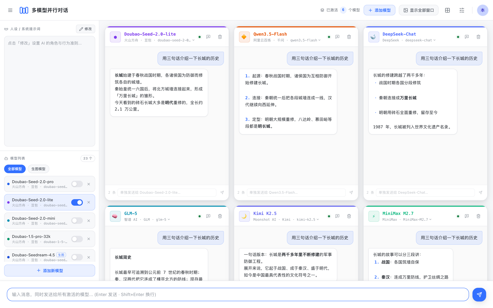
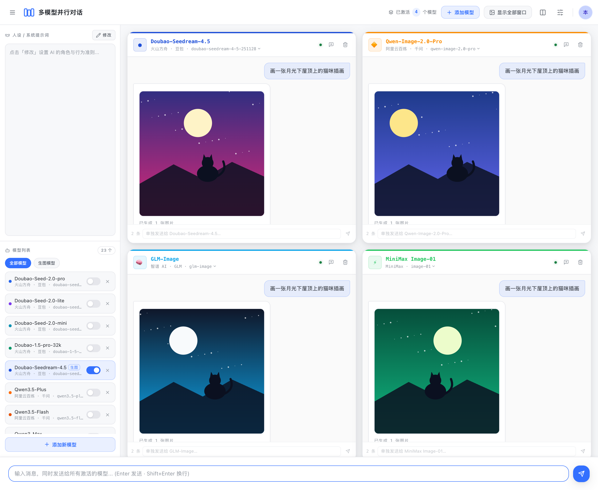
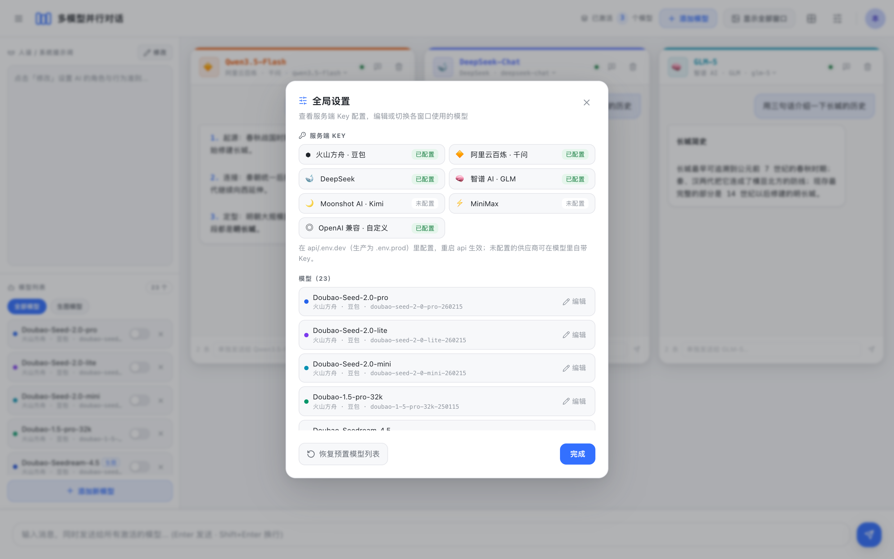
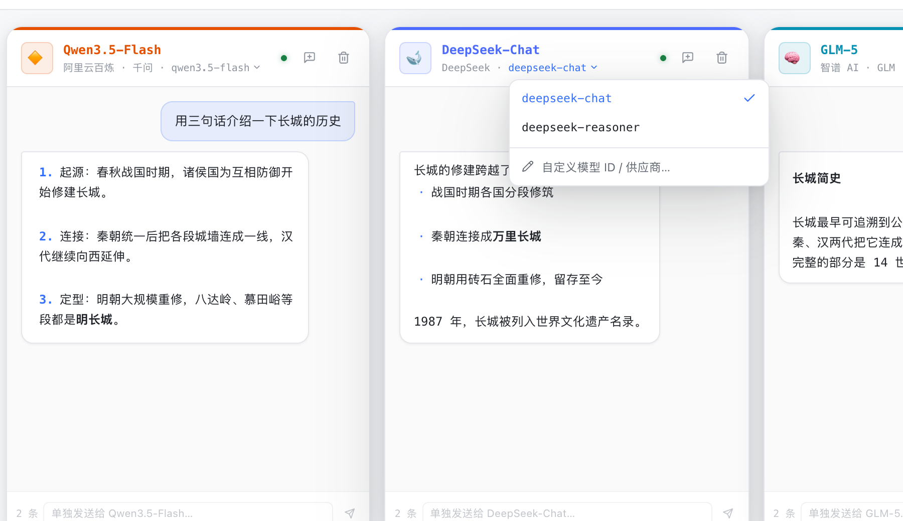
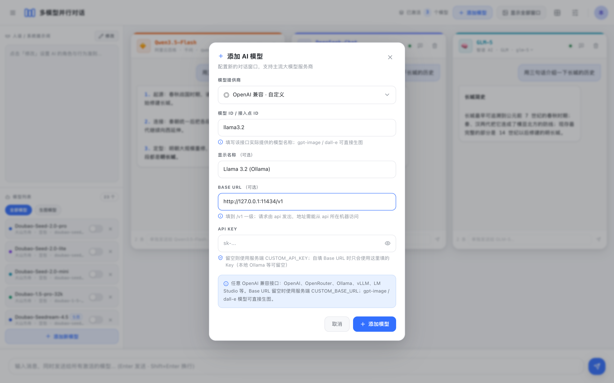
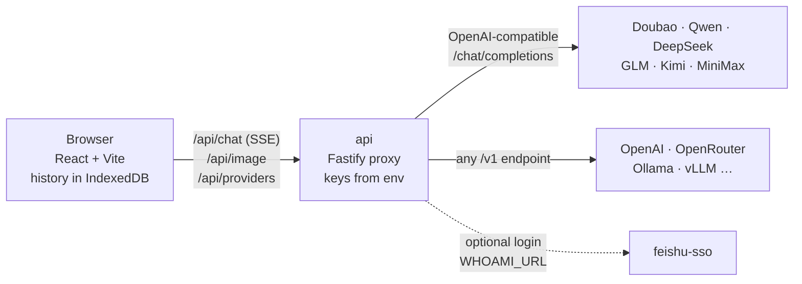

# multi-model-chat

English | [简体中文](README-CN.md)

Send one prompt to many LLMs at once and compare their answers side by side, each window streaming on its own. Works for text-to-image models too.



> The app UI is in Simplified Chinese. Screenshots in this README use mocked demo responses (see [Regenerating screenshots](#regenerating-screenshots)).

## Features

- **Parallel comparison**: the input bar broadcasts to every active model, and each window streams its reply independently. You can also message a single window on its own.
- **Seven provider types, 23 preset models**: Volcengine Ark (Doubao), Alibaba Cloud Model Studio (Qwen), DeepSeek, Zhipu (GLM), Moonshot (Kimi) and MiniMax, plus **any OpenAI-compatible endpoint** (OpenAI, OpenRouter, Ollama, vLLM, LM Studio and others).
- **Switch models at any time**: pick another version from the dropdown in a window's title bar, or edit any model's provider, model ID, name, key or Base URL in **Settings**. Conversation history is kept when you switch.
- **Text-to-image comparison**: qwen-image, glm-image / CogView, doubao-seedream, MiniMax image-01 and OpenAI gpt-image / dall-e render side by side. When a message asks for an image, it goes to the image API automatically.
- **Sensible defaults**: on first launch only models whose provider has a server-side key are activated, so configuring one key doesn't leave you with a screen full of errors.
- **Flexible setup**: a shared persona (system prompt), per-model API keys, 5 grid layouts and 3 color skins.
- **Data stays in your browser**: conversations are stored in IndexedDB, and the model list and settings in localStorage. The server stores nothing.
- **Keys stay on the server**: provider keys live only in the api's environment, and the browser never sees them.

| Text-to-image comparison | Settings |
| --- | --- |
|  |  |

| Switch a window's model version | Add an OpenAI-compatible model (e.g. Ollama) |
| --- | --- |
|  |  |

## Quick start

You need Node.js ≥ 20.19 (22 or 24 recommended) and pnpm 9 (`corepack enable` installs it).

```bash
git clone https://github.com/AI-Pocket-Verse/multi-model-chat.git
cd multi-model-chat
pnpm install
pnpm dev          # first run creates api/.env.dev, then starts api (:4060) and web (:5160)
```

Open <http://localhost:5160>. By default the app runs in **local single-user mode**, so you don't need to log in.

Then add keys in either of two ways:

1. **Server-side (recommended)**: fill in one or more `*_API_KEY` values in `api/.env.dev` (see [Configuration](#configuration)), then restart `pnpm dev`.
2. **Per model**: open **Settings** (the sliders icon at the top right) → **Edit** a model and paste its own key. The key is stored only in your browser and sent with each request for the api to forward.

If neither exists, the chat window tells you which variable to set.

## Run with Docker

```bash
cp api/.env.example api/.env.docker   # optional: add your provider keys here
docker compose up -d --build
```

Open <http://localhost:4060>. One image serves both the web app and the api. The port is published on `127.0.0.1` only, because local mode has no login. To reach Ollama on the host from the container, use `http://host.docker.internal:11434/v1` as a custom model's Base URL.

## Using OpenAI-compatible endpoints

Choose the **OpenAI 兼容 · 自定义** (OpenAI-compatible) provider when you add or edit a model:

| Service | Base URL | API key |
| --- | --- | --- |
| OpenAI | `https://api.openai.com/v1` | required |
| OpenRouter | `https://openrouter.ai/api/v1` | required |
| Ollama (local) | `http://127.0.0.1:11434/v1` | leave empty |
| vLLM / LM Studio | your server's `/v1` URL | depends |

To share one endpoint with all users, set `CUSTOM_BASE_URL` / `CUSTOM_API_KEY` on the server and leave Base URL empty in the UI. Models named `gpt-image-*` or `dall-e-*` generate images through `/images/generations`.

Requests are sent by the api, so the Base URL must be reachable **from the api's machine**. Security rules:

- The server's `CUSTOM_API_KEY` is **never** sent to a Base URL that comes from the browser. Only the key entered for that model is used.
- Browser-supplied Base URLs are allowed in local mode and **blocked by default once login is enabled** (`ALLOW_USER_BASE_URL`). On a shared server, an arbitrary URL would let users probe your internal network (SSRF).
- Only `http://` and `https://` URLs are accepted.

## How it works



- `/api/chat` pipes the provider's SSE stream to the browser unchanged. The api does not parse or rewrite it. Provider errors are passed through with their status code, body and an `x-upstream-error` header, so the UI can tell a provider 401 from its own login 401.
- When the browser disconnects, the api cancels the provider request, so closing the page stops billing. The UI stops a model after 120 s without any data and marks replies cut off mid-stream as incomplete.
- Failed and interrupted replies are never sent back as context in the next turn.

## Configuration

The api loads its config with Node's native `--env-file`: `pnpm dev` reads `api/.env.dev`, `pnpm start` reads `api/.env.prod`, and Docker reads `api/.env.docker`. None of these files is committed. The template is [`api/.env.example`](api/.env.example).

| Variable | Default | Description |
| --- | --- | --- |
| `ARK_API_KEY` | empty | Volcengine Ark (Doubao). Create one in the [Ark console](https://console.volcengine.com/ark/region:ark+cn-beijing/apiKey) |
| `QWEN_API_KEY` | empty | Alibaba Cloud Model Studio (Qwen). See [Get an API key](https://help.aliyun.com/zh/model-studio/get-api-key) |
| `DEEPSEEK_API_KEY` | empty | DeepSeek, from [API keys](https://platform.deepseek.com/api_keys) |
| `ZHIPU_API_KEY` | empty | Zhipu (GLM), from [API Keys](https://bigmodel.cn/usercenter/proj-mgmt/apikeys) |
| `KIMI_API_KEY` | empty | Moonshot (Kimi), from [API Keys](https://platform.moonshot.cn/console/api-keys) |
| `MINIMAX_API_KEY` | empty | MiniMax. See [How to get an API key](https://platform.minimaxi.com/docs/faq/about-apis) |
| `CUSTOM_BASE_URL` / `CUSTOM_API_KEY` | empty | Default OpenAI-compatible endpoint and key, e.g. `https://api.openai.com/v1` |
| `ALLOW_USER_BASE_URL` | auto | Whether the browser may enter its own Base URL. Empty means allowed in local mode and blocked with login |
| `HOST` / `PORT` | `127.0.0.1` / `4060` | Address the api listens on |
| `ALLOWED_HOSTS` | empty | Local mode accepts only `localhost` / `127.0.0.1` / `::1` as the Host header (blocks DNS rebinding). Add the domain or LAN IP you use to open the app |
| `TRUST_PROXY` | `loopback` | Trusted reverse proxies (IP / CIDR list), so rate limiting uses the real client IP. Hop counts and `true` are rejected |
| `CORS_ORIGINS` | empty | Leave empty for same-origin setups. For cross-origin access, list allowed origins separated by commas or spaces |
| `WEB_DIST_DIR` | unset | Serve `web/dist` from the api (used by Docker) |
| `WHOAMI_URL` | unset | Enables Feishu login (see below) |

### Optional: Feishu login

Without `WHOAMI_URL` the app runs in local single-user mode. To share it with a team, add login with the companion open-source [feishu-sso](https://github.com/AI-Pocket-Verse/feishu-sso) service:

1. Deploy feishu-sso and have your reverse proxy forward `/auth/*` on the same domain to it (the login cookie must be same-origin).
2. Set `WHOAMI_URL` on the api to feishu-sso's whoami endpoint, e.g. `http://127.0.0.1:4020/api/whoami`.
3. Build web with `VITE_SSO_BASE=/auth` (for example in `web/.env.local`).

Configure both sides together, because with only one side configured, web and api disagree on who the current user is. Once login is on, unauthenticated requests get 401 and never use the server keys.

## Security notes

- **Local mode has no authentication.** Anyone who can reach the api can spend your keys. That's why `HOST` defaults to `127.0.0.1` and Docker publishes on `127.0.0.1`. Before exposing the app to other people, enable login.
- Keys you enter in the UI are saved in the browser's localStorage in plain text. Use them only on devices you trust.
- Image URLs returned by providers are limited to `http(s)` and `data:image`, and model output is HTML-escaped before rendering.

## Deployment (systemd + nginx)

`deploy/` contains templates for a single-host setup: nginx serves the static files and reverse-proxies the api, with buffering disabled for streaming replies.

```bash
git clone https://github.com/AI-Pocket-Verse/multi-model-chat.git /opt/multi-model-chat && cd /opt/multi-model-chat
pnpm install && pnpm build
cp api/.env.example api/.env.prod   # set NODE_ENV=production, your keys and WHOAMI_URL

sudo cp deploy/systemd.service.template /etc/systemd/system/multi-model-chat.service
sudo sed -i 's|__INSTALL_DIR__|/opt/multi-model-chat|; s|__SERVICE_USER__|www-data|' /etc/systemd/system/multi-model-chat.service
sudo systemctl daemon-reload && sudo systemctl enable --now multi-model-chat

sudo cp deploy/nginx.conf.template /etc/nginx/sites-available/multi-model-chat
sudo sed -i 's|__INSTALL_DIR__|/opt/multi-model-chat|; s|__SERVER_NAME__|chat.example.com|' /etc/nginx/sites-available/multi-model-chat
sudo ln -sf /etc/nginx/sites-available/multi-model-chat /etc/nginx/sites-enabled/ && sudo nginx -t && sudo systemctl reload nginx
```

If you run local mode behind nginx for yourself, add your domain to `ALLOWED_HOSTS`.

## Development

| Command | What it does |
| --- | --- |
| `pnpm dev` | Local development (web proxies `/api` to the api through Vite) |
| `pnpm build` | Builds api (`api/dist`) and web (`web/dist`) |
| `pnpm typecheck` | Type-checks every package |
| `pnpm test` | Runs all unit tests |
| `pnpm screenshots` | Regenerates the README screenshots |

```
api/        Fastify api: /api/chat (streaming proxy), /api/image, /api/providers
web/        React front end
shared/     Request / response types shared by api and web
packages/   Small shared packages (login clients, HTTP client, skin tokens, Tailwind preset…)
deploy/     systemd / nginx templates
scripts/    Maintenance scripts (screenshots)
```

To add a provider, update `ProviderKey` in `shared`, `api/src/env.ts`, `PROVIDER_API` in `api/src/providers.ts`, `PROVIDER_KEY_ENV` in `web/src/lib/errors.ts`, the catalog in `web/src/lib/catalog.ts`, and the configuration table above.

### Regenerating screenshots

`pnpm screenshots` starts Vite on port 5199 and drives the locally installed Google Chrome with Playwright. It intercepts every `/api/*` call with canned demo data, so it needs no keys and makes no network calls. The pictures in the image comparison are SVGs generated by the script. To use Playwright's bundled Chromium instead, run `pnpm exec playwright install chromium` and set `PW_CHANNEL=` (empty).

## License

[MIT](LICENSE)
